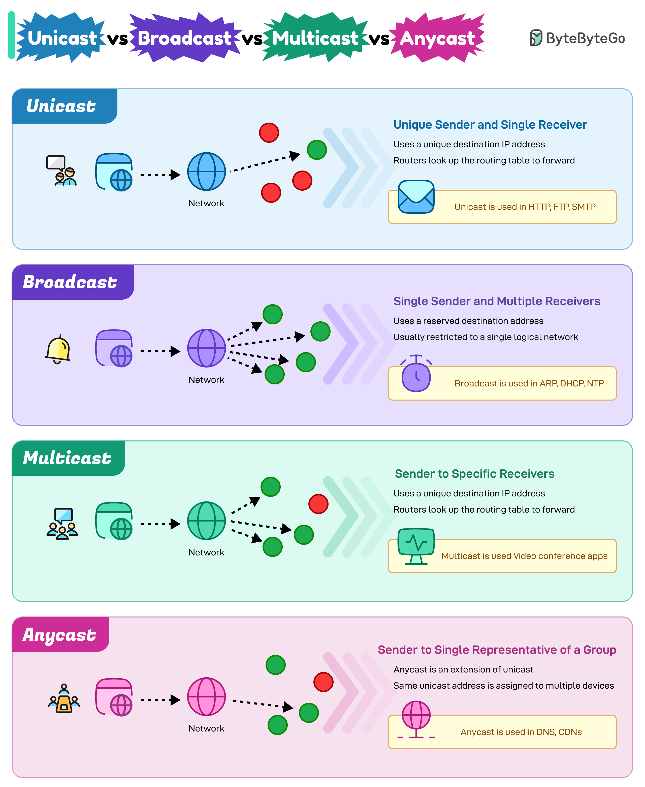

## Question 

Explain unicast, broadcast, multicast, and anycast.

## Answer 

In computer networking, unicast, multicast, broadcast, and anycast describe how data packets are routed from a sender to receivers. 
As explained in the guide by ByteByteGo, each model serves a distinct communication purpose: 

### 1. Unicast (One-to-One)

* Definition: Data is sent from a single sender to a single specific receiver.
* How it works: Uses a unique destination IP address for the target device.
* Examples: Web browsing (HTTP/HTTPS), sending an email, SSH, and file transfers (FTP).
* Pros/Cons: Reliable and secure point-to-point delivery, but scales poorly if you need to send the exact same file to thousands of separate users (requires sending separate copies to each). 

### 2. Broadcast (One-to-All)

* Definition: Data is sent from a single sender to every device on a local network segment (subnet).
* How it works: Uses a special broadcast address; every device on the LAN receives and processes the packet, whether they want it or not.
* Examples: Address Resolution Protocol (ARP) requests and DHCP discovery.
* Pros/Cons: Simple for local discovery, but wastes bandwidth and processing power on uninterested devices; restricted to local subnets and typically not forwarded by routers (and eliminated in IPv6). 

### 3. Multicast (One-to-Many / Group)

* Definition: Data is sent from a sender to a specific group of devices that have subscribed to receive it.  
* How it works: Devices join a designated multicast group (using protocols like IGMP), and routers replicate and forward the stream only to subnets with active group members.
* Examples: IPTV, live video conferencing, and online gaming. 
* Pros/Cons: Bandwidth-efficient for group distributions (the sender transmits the stream only once), but requires supporting infrastructure across the network switches and routers. 

### 4. Anycast (One-to-Nearest in a Group)

* Definition: Data is sent from a sender to the closest or best-performing receiver out of a group of receivers that share the same IP address.  
* How it works: Multiple servers in different geographic locations advertise the exact same IP address via BGP (Border Gateway Protocol), and routing tables direct the user to the topologically nearest node.
* Examples: Global DNS querying (like root DNS servers) and Content Delivery Networks (CDNs). 
* Pros/Cons: Lowers latency, balances loads naturally, and provides strong resilience against Distributed Denial of Service (DDoS) attacks. 

### Quick Comparison Table

| Feature | Unicast | Broadcast | Multicast | Anycast |
|---|---|---|---|---|
| Scope | One-to-One | One-to-All (Local) | One-to-Many (Group) | One-to-Nearest |
| Target | Specific single receiver | Every device on subnet | Subscribed group members | Closest server sharing IP |
| Bandwidth | Moderate (scales with users) | High (wastes resources) | Efficient (single stream) | Optimal / Low latency |
| Key Protocols | TCP, UDP, HTTP | ARP, DHCP | IGMP, PIM, IPTV | BGP, DNS |
